# Edison Format Simulator

A Yu-Gi-Oh! **Edison Format** duel simulator for phone and desktop browsers. Edison is the
April 2010 TCG format (SJC Edison, Master Rule 2 era). The app has a full rules engine, AI
opponents, a deck builder, booster packs and a collection, Draft and Sealed, a simulated local
tournament scene, and online duels and tournaments with friends. It installs to your home screen
and works offline.

> Fan-made, non-commercial project. Card names belong to their owners; card art, sleeves and
> playmats are procedurally generated, and card texts are paraphrased.

<p align="center">
  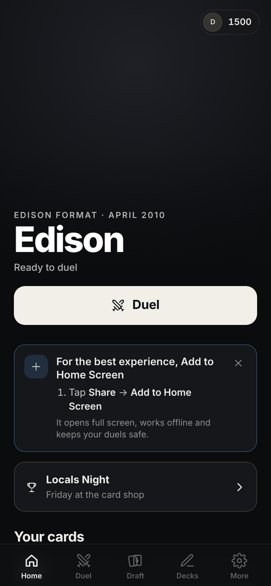
  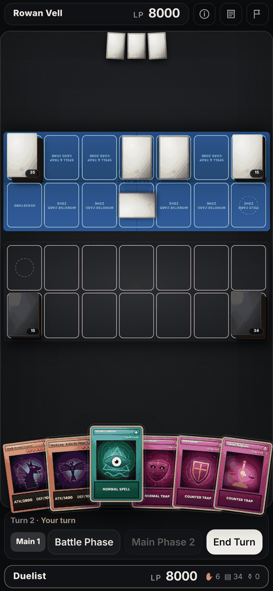
  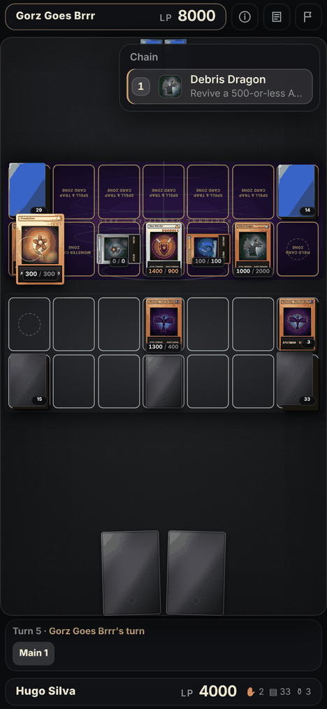
  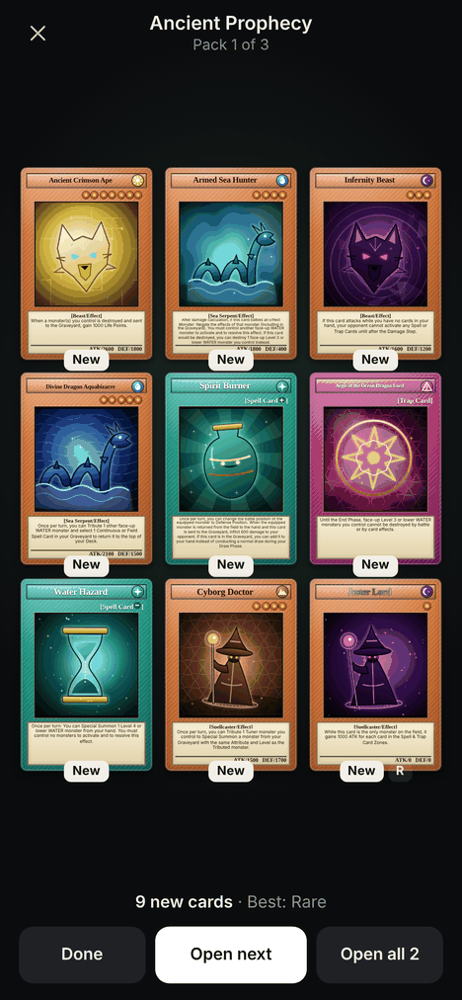
</p>
<p align="center">
  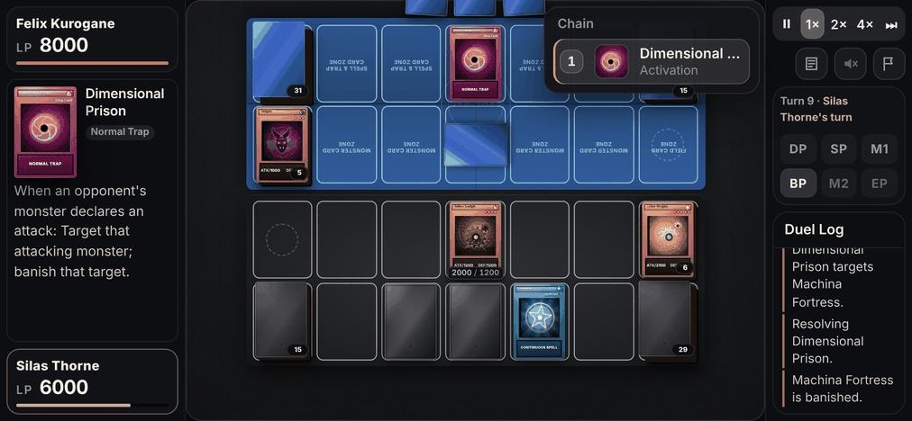
</p>

## Features

### Duels

- **Rules engine** (`src/engine`): chains with spell speeds, SEGOC trigger ordering, "missing
  the timing", turn player priority, summon negation windows (Solemn Judgment, Royal Oppression),
  the damage step, battle replays, Synchro, Fusion and Ritual summons, contact fusions, equips,
  continuous effects, tokens, flip effects and once-per-turn tracking. Edison-era rules: the first
  player skips the draw, one face-up Field Spell, 6-card hand limit.
- **1,359 scripted cards**: every card from the 18 booster sets of the era (Gladiator's Assault
  to Turbo Pack: Booster Three, including Hidden Arsenal and the Gold Series), the 4 Structure
  Decks (Zombie World, Spellcaster's Command, Warriors' Strike, Machina Mayhem), plus the Edison
  Forbidden & Limited list.
- **55 premade decks with Side Decks**: the format's archetypes (Quickdraw Plant, Lightsworn,
  Blackwings, Zombies, X-Sabers, Gladiator Beasts, Frog Monarchs, Tele-DAD, Hero Beat, Six
  Samurai, Machina Gadgets, Gravekeeper's and many more) and 31 real tournament decklists from
  SJC Edison and the Edison community.
- **AI opponents**: easy, normal and hard. The AI summons, synchros, chains traps, plays around set
  cards and uses card-specific hints.
- **Duel screen**: portrait and landscape layouts, card previews, chain display, duel log,
  graveyard viewer that says when a card's effect can be used, a target picker that shows whose
  card and which zone, and an explanation when a card can't be used right now. "Smart" response
  prompts only stop when you have a relevant card. Tap to hurry the AI.
- **Resume duels**: leave a duel and pick it up later, even after closing the app.
- **Watch AI vs AI**: spectate an exhibition between two AI duelists at 1×, 2× or 4× speed.

### Play modes

- **Quick Duel**: pick your deck and opponent, single game or best of three, with side decking
  between games.
- **Locals Night**: Friday at the card shop. Three shops with their own regulars and metagames,
  Swiss rounds and a Top Cut.
- **Events and the Circuit**: Locals, Regional Qualifiers, Shonen Jump Championships and a
  National Championship. Start an optional 12-week season and earn your invite to Nationals.
- **Tournament**: a practice Swiss tournament with 8, 16 or 32 players, OMW% tiebreakers, a Top 8,
  best-of-3 matches, and simulated or played-out AI matches.
- **Draft and Sealed**: Booster Draft against AI drafters, or Sealed, with real era packs. Choose
  the sets, players and match length, and save presets.
- **Play a friend**: online duels on two phones, peer to peer, with a room code.
- **Friends Locals**: a private Swiss tournament for 3 to 8 friends, each on their own phone.

### Collection and decks

- **Packs and Binder**: buy era booster packs and Structure Decks with Duel Points, open them
  card by card, and track your collection by set. Optionally build decks only from cards you own.
- **Card Shop and trades**: buy singles from a glass case whose stock changes every Friday and sell your cards to
  the buylist. Prices follow rarity and how much of the 2010 field plays each card; older-set cards like Gorz and
  Dandylion can be bought as singles. Trade with the Locals regulars, who have their own binders, want lists and
  bargaining styles.
- **Deck builder**: searchable card database, live banlist and legality checks, test hands, stats,
  Side Deck, and decklist import and export.
- **Profile and ratings**: Constructed and Limited ratings, trophies and win rates by deck.

### App

- **Installable phone app**: add it to your home screen; it runs offline, and updates install
  quietly without interrupting a duel.
- **Sound and music**: card and impact sound effects, haptics, and shuffled lo-fi playlists for
  the menu, duels and the pinch. All bundled audio is CC0; Settings → Audio credits lists every
  file. Settings → Your music plays your own audio files instead.
- **Customization**: sleeves, playmats (or a photo of your own), player name, animation speed.
- **Official card images (optional)**: Settings → "Load official card images" fetches artwork
  from the public YGOPRODeck database when online, and falls back to generated art.
- **Report a problem**: builds a bug report with your device details that you can share or copy.
- **How to Play**: the format, its duel rules, the card pool and the banlist, in the app.

## Screenshots

| | | | |
| :---: | :---: | :---: | :---: |
| 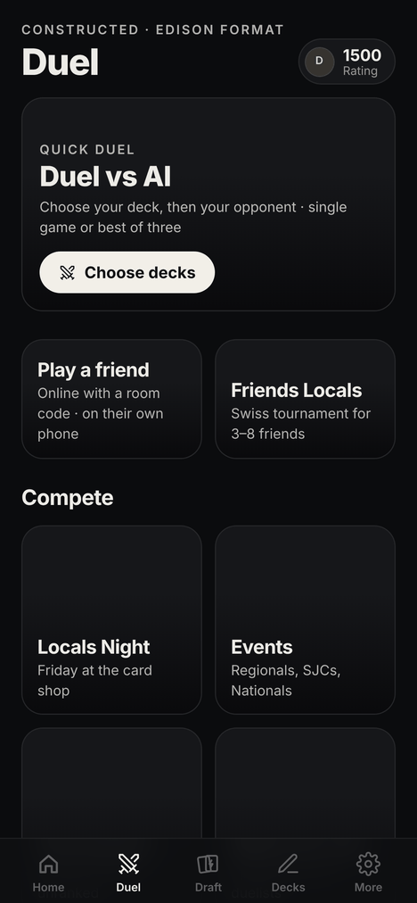<br>Duel hub | 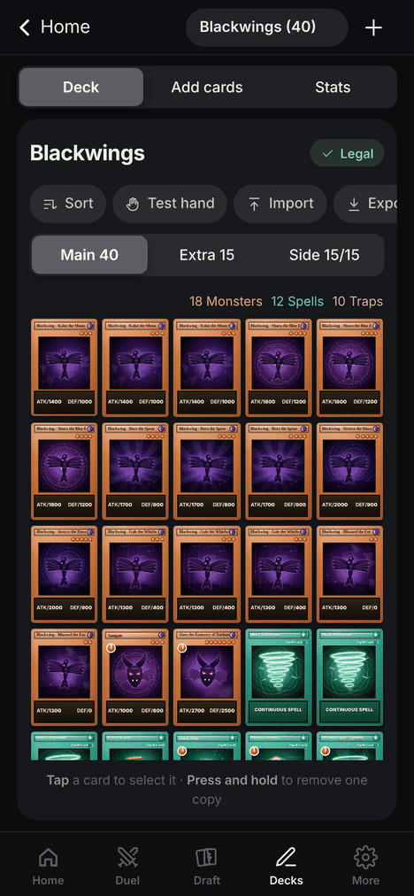<br>Deck builder | 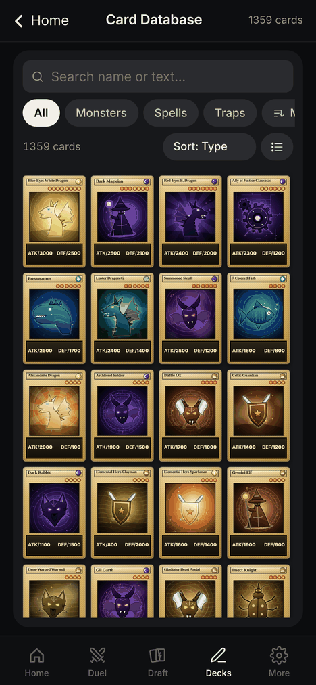<br>Card database | 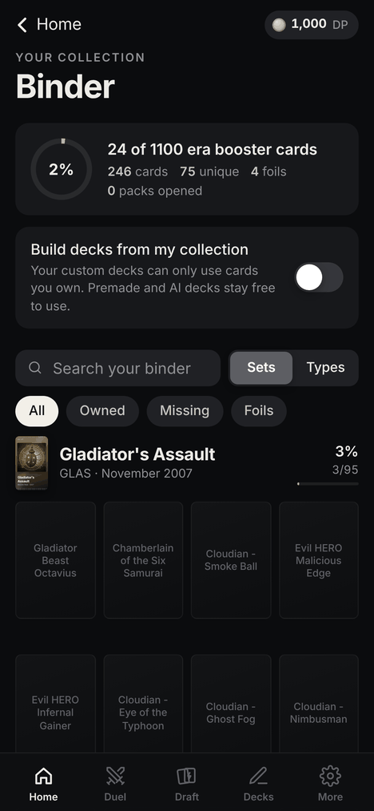<br>Binder |
| 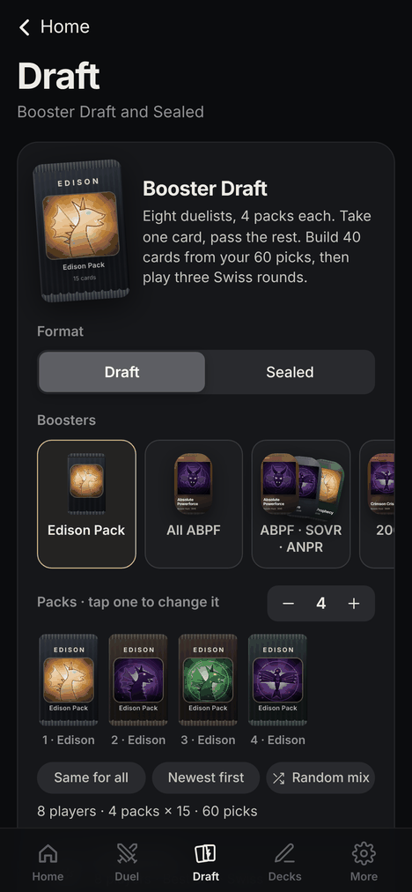<br>Draft and Sealed | 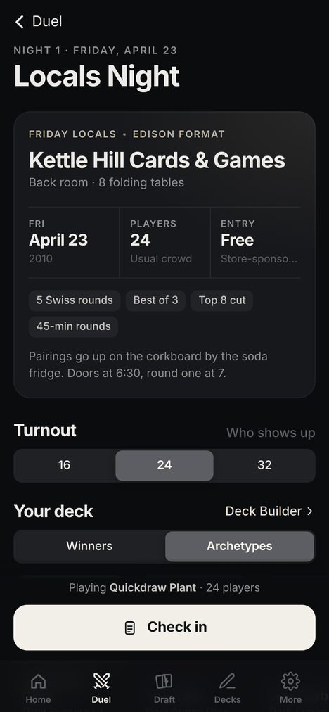<br>Locals Night | 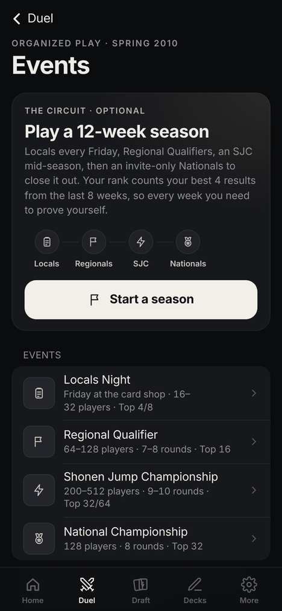<br>Events and the Circuit | 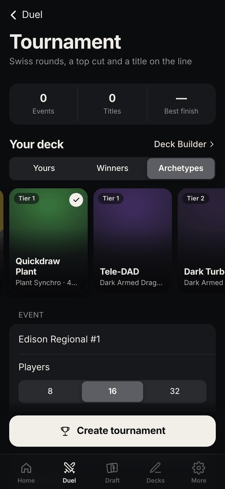<br>Tournament |
| 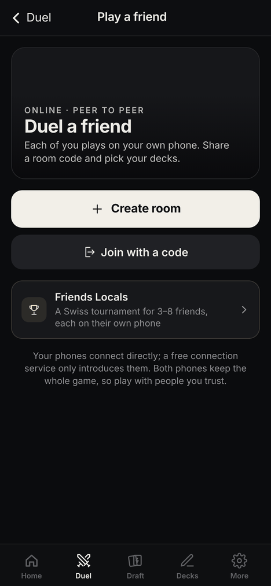<br>Play a friend | 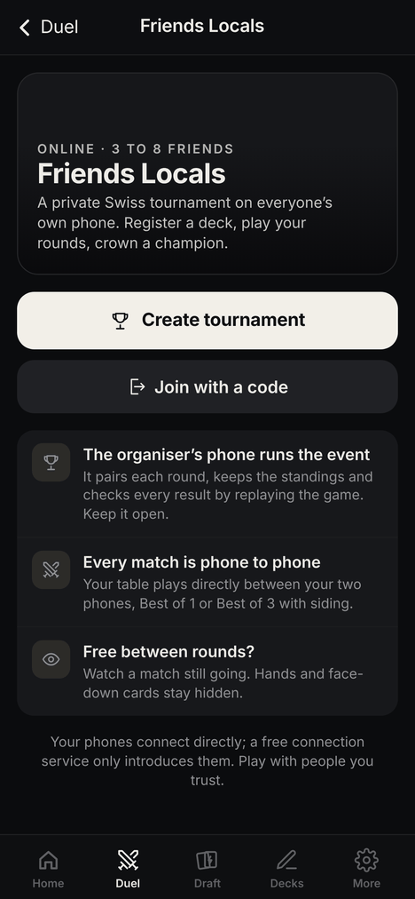<br>Friends Locals | 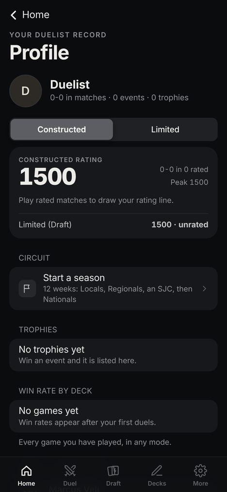<br>Profile | |

## Getting started

```bash
npm install
npm run dev           # http://localhost:5173
npm run build         # production build in dist/
npm run build:single  # single self-contained HTML file in dist-single/
```

Every push to `main` is tested and published to GitHub Pages by `.github/workflows`.

Developer harness: `npm run dev`, then open `/duel-dev.html` (`?gallery` shows every card,
sleeve and playmat; `?mode=spectate&seed=N` runs AI-vs-AI duels).

## Testing

```bash
npm run typecheck
npm test             # everything below except the browser tests
npm run test:rules   # deterministic rules tests (battle, chains, negation, synchro...)
npm run test:sim     # AI-vs-AI duels across all premade decks (catches script errors)
npm run test:replay  # record and replay duels deterministically
npm run test:packs   # booster pack pull rates
npm run test:draft   # Draft and Sealed setup
npm run test:locals  # simulated Locals nights
npm run test:events  # Events and Circuit seasons
npm run test:net     # online duels and reconnects
npm run test:tourney # Swiss pairing, standings and top cut
npx tsx scripts/sim.ts --deck blackwings --vs lightsworn --games 50 --verbose
npx tsx scripts/sim.ts --deck quickdraw-plant --games 1 --log   # full duel log
```

Browser tests (Playwright, against a `npm run build`): `test:routes-e2e`, `test:friend-e2e`,
`test:friends-locals-e2e`, `test:monkey-e2e` and `test:shop-e2e`.

## Project layout

| Path | Contents |
| --- | --- |
| `src/engine/` | Game state, chain/battle/summon rules, effect context API, replays |
| `src/cards/` | Card DSL (`define.ts`), helpers, banlist and card scripts (`sets/*.ts`) |
| `src/decks/` | Premade and tournament decks, deck validation, side decking |
| `src/ai/` | Heuristic AI controller |
| `src/collection/` | Era sets, Structure Decks, booster packs and the player's collection |
| `src/draft/` | Booster Draft and Sealed, AI drafters and deck building |
| `src/locals/` | Locals Night: shops, regulars, metagame, Swiss and top cut |
| `src/events/` | Events, the Circuit season and ratings |
| `src/tournament/` | Practice tournaments: Swiss pairing, standings, top cut, match simulation |
| `src/net/` | Online duels and Friends Locals (PeerJS, peer to peer) |
| `src/ui/` | Duel screen, card rendering, themes, audio, menus and every screen |
| `scripts/` | Headless simulator, rules tests and browser tests |
| `docs/CARD_SCRIPTING.md` | How to add or script new cards |
| `docs/screenshots/` | README screenshots |

## Known simplifications

The engine covers the format's real interactions, but a few rare mechanics are approximated
(each is documented in `docs/engine-requests/`): Gemini monsters use a "Gemini Summon" effect
that consumes the Normal Summon, effects that "end the Battle Phase" stop further attacks instead,
Fusion Summons made by card effects can't be negated by Solemn Judgment, and some lingering effects
(Swords of Revealing Light's countdown) use the chain.
